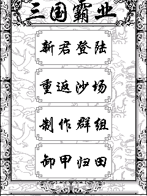
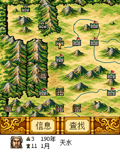
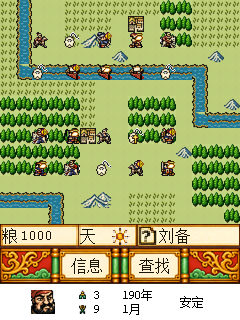
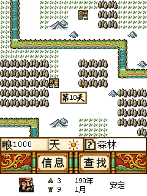

# BBK9588-sango（三国霸业 C 重建与兼容修复）

面向步步高 9588/C200 环境，将提供的《三国霸业》BDA 整理为可重新编译的 MIPS C 工程，
共 446 个恢复函数，并修复原 9588 移植中的状态栏、战斗动画、制作群组和战斗界面布局问题。
恢复逻辑已按战斗、战略、存读档、资源、界面和运行库拆成42个模块，函数采用语义名称；
大型流程和剩余短函数已整理变量名与标签，仍保留部分恢复出的布局和控制流；本项目不是原开发者的工程。

当前版本为 **0.1.0-alpha.1**，源码托管于
[HelloClyde/BBK9588-sango](https://github.com/HelloClyde/BBK9588-sango)。
构建状态见 [GitHub Actions](https://github.com/HelloClyde/BBK9588-sango/actions)；版本标签和 Release 尚未发布。
原游戏恢复代码及改编素材没有已提供的开源许可证；新增独立代码与上游 SDK 的许可范围
分别记录于 [LICENSE.md](LICENSE.md) 和 [来源声明](THIRD_PARTY_NOTICES.md)，请勿将整仓视为 MIT 授权。

## 快速开始

发布前可按下方命令本地构建。正式发布后，从本仓库 Releases 选择同一版本的 `-update.zip`，
或同时下载独立 BDA 和 `sango.lib`。
仅更换应用图标为 9288S 原图的彩色高清重绘，游戏内仍使用原灰度资源及已恢复的底栏。

适用于此前验证的 **9588/C200 固件环境**；不宣称适配所有 BBK 机型。
升级 ZIP 中的目录与设备内置存储根目录对应：

```text
应用/
├── 程序/
│   └── 三国霸业.bda
└── 数据/游戏/
    └── sango.lib
```

源码包含原 `sango.LIB` 完整解包素材与新增素材，构建时重新生成 `sango.lib`。
新版资源库为 461116 字节，包含原 87 条资源和补充底栏、制作群组两条资源，随升级包安装。
文件名沿用原来的 **sango.lib**，不是 sanguo.lib；Windows/设备中的旧拼写 `sango.LIB` 是同名文件。
本包不包含系统固件、原版 BDA、字库转储或个人存档。

升级前保留设备同名程序及资源备份，把 `应用` 目录合并到内置存储根目录。
安全弹出设备、退出 USB 存储模式后，从“娱乐天地”打开《三国霸业》。不要把整个源码目录复制进设备。
程序沿用 `系统/数据/游戏/sango0.sav`、`sango1.sav` 等原存档路径，升级包不覆盖它们。

方向键选择／移动，确定执行，返回取消；触摸“信息／查找”打开相应信息页。
战斗状态行与按钮栏相邻，一位及两位天数弹窗均在屏幕中央。

### 开发者构建

在仓库根目录执行（Windows PowerShell，Python 3.11+）：

```powershell
git submodule update --init sdk
powershell -ExecutionPolicy Bypass -File sdk/scripts/setup_toolchain.ps1
python -m pip install -r requirements-assets.txt
python build.py
python tools/package_release.py --require-validated
python tools/verify_artifacts.py --require-validated
```

已有编译器时可指定路径：`python build.py --cc PATH/TO/mipsel-none-elf-gcc.exe`，
或设置 `SANGO_CC`。构建需要 Pillow 编码仓库中的图片，无需图像生成服务或原版 BDA/LIB 文件。

输出 `build/三国霸业.bda` 和 `build/sango.lib`；打包输出在 `dist/`，包括独立 BDA、`sango.lib`、升级 ZIP、`BUILD_INFO.json`
及逐文件 `SHA256SUMS.txt`。普通构建不会发布任何远程内容。
`--require-validated` 要求 BDA 与运行证据、LIB 与资源验证记录分别相符；修改代码或素材后，须重新验证并更新参考记录。

### 阅读与修改源码

从 [源码导航](docs/SOURCE_GUIDE.md) 开始，入口流程在 `src/app/lifecycle.c`，
战略月份循环在 `src/strategy/turns.c`，战斗日循环在 `src/battle/controller.c`。
[函数索引](docs/FUNCTION_INDEX.md) 列出全部446个函数的新名称、原地址及文件位置；
`python tools/source_index.py --find battle_run` 可从命令行查询。
武将、城市和部队结构见 `include/sango_state.h`，旧状态区地址集中在 `include/sango_legacy_memory.h`。

修改模块后运行 `python tools/source_index.py --check` 和资源用途检查，再重新构建。
构建生成的 `build/sango_engine.c` 仅按固定顺序包含各模块，以保持原布局和优化；日常编辑直接修改功能模块。
第一阶段模块拆分保持了 BDA 字节一致；第二阶段继续整理95个函数、减少113处跳转，
编译结果会变化，资源库保持不变。新旧代码对照及验证范围见 [复杂函数整理](docs/CONTROL_FLOW_REFACTOR.md)。
随后整理剩余249个函数的1516个变量/参数名和54个标签，446个函数已无旧式临时命名。
这一步的 ELF、BDA 和 LIB 均与已验证版本逐字节一致，见 [短函数命名整理](docs/IDENTIFIER_CLEANUP.md)。

### 素材编辑与 LIB 回包

[assets/](assets/README.md) 统一保存解包资源、GPT Image 母图、目标尺寸图片、提示词和原图参考，
包括此前保留的三张彩色草稿。`assets/library/manifest.json` 是 LIB 打包入口。
解包素材按代码中的实际用途命名；头像按各剧本的原姓名表命名，见 [资源目录](assets/library/资源目录.md)
与 [逐项代码核对](assets/library/代码用途核对.md)。没有明确调用依据的内容保留待确认标记。

```powershell
python tools/sango_lib.py pack
python tools/sango_lib.py pack --original-only -o build/sango-original.lib
python tools/test_sango_lib.py
```

默认输出 `build/sango.lib`。原库未修改时，`--original-only` 可逐字节还原 439720 字节原文件。
已导出 1202 张 PNG、27 组动画指令及 7 张战场地图；包括100～107号菜单选中动画。
其余24条原资源保留二进制记录，无遗漏回包。
新增底栏/制作群组以同一份 PNG 生成 LIB 条目和当前 C 内嵌数据；应用图标由 SDK 打入 BDA。
详细格式、编辑约束及解包命令见 [资源说明](assets/library/README.md)。
`python tools/audit_resource_usage.py --check` 可检查89项资源的命名依据、调用表达式和选择表是否仍与代码相符。

## 截图

以下均为计划发布的确切 BDA 在本地 C200 固件模拟器中的真实截图，非真机截图或设计稿。
战斗图片来自受控战场界面夹具；未宣称完整战斗或战役已验证。

| 主菜单 | 战略地图 | 战斗界面 |
| --- | --- | --- |
|  |  |  |

| 天数弹窗 | 制作群组 |
| --- | --- |
|  |  |

验证方法、精确哈希和未覆盖范围见 [验证记录](docs/VALIDATION.md)。

## 依赖

- **使用成品**：9588/C200 环境，安装同一版本的 BDA 与 `sango.lib`，不需要 SDK 或 Python。
- **SDK**：[HelloClyde/BBK9588-bda-sdk](https://github.com/HelloClyde/BBK9588-bda-sdk)，
  子模块固定 `ef3bf3b7328a3a8fa9ba48593c63285300725fb7`，没有自动升级。
- **工具链**：MIPS O32 小端、soft-float，已验证 GCC 15.2.0；SDK 安装脚本校验工具链 ZIP 的 SHA-256。
- **构建**：Git、Python 3.11+ 和 Pillow 12.3.0；本地验证使用 Python 3.11.5，CI 配置为 Python 3.12/Windows。
- **素材依赖安装**：`python -m pip install -r requirements-assets.txt`。
  母图与提示词已保存。`tools/pack_*.py` 只重新编码已有母图，不访问图像生成服务。
- **模拟器复验**：用户自行提供兼容 QEMU、C200 固件和 NAND；它们不会上传仓库或 CI。

项目私有的 SDK 兼容扩展放在 `include/bda_sango_compat.h`，不会修改 `sdk/` 子模块。
公共 SDK 接口可用后，通过 `include/sango_sdk_bindings.h` 切换，游戏调用处保持命名接口。

## 感谢

- 原游戏制作群组：策划 **BBK gamegroup**；程序 **通宵虫、南方小鬼**；美工 **Sunday**。
- **HelloClyde / BBK9588-bda-sdk**：SDK、BDA 编码与校验工具。
- 提供原文件、9588 真机反馈、9288S 对照及修复需求的使用者。
- 应用图标、恢复底栏和制作群组母图通过 GPT Image 生成；来源和提示词在 `assets/` 中保存。

致谢不改变原作、SDK 或素材的许可范围。发布步骤见 [发布说明](docs/RELEASING.md)。
