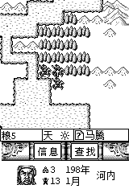
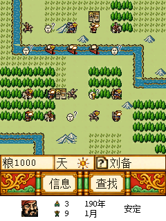

# 战斗底栏与 9288S 的对照

9288S 的底部有三层：粮草／天气／人物或地形状态行、“信息／查找”按钮，以及最下方的势力摘要。
原版在战斗中仍保留战略地图留下的君主头像、城池数、武将数、年月和当前城市名。
此前漏掉过最下方摘要，随后为放回摘要把按钮图纵向压缩，导致文字和边框变扁。本次恢复按钮源图的完整比例，并调整战场可视区为15列14行。

本次已用原版9288S程序通过正常输入新开一局、出征并进入战斗，确认最下方内容。
截图与EXE／固件哈希记录在 `validation/9288s-battle-layout-reference.json`；原始NAND、程序和个人存档没有修改或收入仓库。

| 9288S 原版实际战斗画面 | 新版9588固件模拟器 |
| --- | --- |
|  |  |

9588图片来自受控战场界面夹具，头像／计数／日期输入与原版截图不同，用于检查实际绘制和交互。
两者均为原生固件模拟器截图，没有把设计图当作运行截图；尚未完成本版真机或完整战役验证。

| 内容 | 9288S 原坐标 | 新版9588坐标 |
| --- | --- | --- |
| 粮草数值 | (14,163) | (21,228) |
| 天气图标 | (75,162)，12×12 | (112,227)，18×18 |
| 人物／地形／错误文字 | (106,162) | (159,228) |
| 状态行 | (0,160)，160×16 | (0,224)，240×24 |
| 信息／查找按钮栏 | (2,176)，160×24 | (0,248)，240×36 |
| 势力摘要区域 | (0,200)，160×40 | (0,284)，240×36 |
| 君主头像 | (21,206)，24×24 | (31,290)，24×24 |
| 城池数／武将数 | (63,205)／(63,219) | (94,289)／(94,303) |
| 年／月 | (82,205)／(82,219) | (123,289)／(123,303) |
| 城市名 | (120,212) | (180,296) |

目标屏为240×320，不能把160×240的全部高度直接放大1.5倍。
战场可视区为240×224（15列14行），状态行在224～247行，按钮图按原240×36完整绘制在248～283行，
摘要在284～319行，使用24×24原头像和两行12像素文字。原按钮图的文字、边框和花纹不再缩放。
相机卷动、地图拷贝、地形／部队／光标／目标／移动标记和特效的显示边界同步为14行，全部战场格子仍可访问。
移动、AI和计谋计算的15×15规则窗口及缓存容量保持不变。
触摸信息范围为x=60～113，查找为128～181，共用y=250～281；摘要区域不会触发这两个按钮。

摘要数据取最后一次战略地图绘制的快照，复现原版的保留方式，不把战斗单位信息冒充战略统计。
战斗重绘不重新统计武将，也不改共享文字缓冲；UI快照不进入存档。
“天”指天气；第几天弹窗仍用原有独立居中逻辑。背景和天气通过命名SDK接口绘制，不新增系统GUI表指针。
现有GPT Image母图、240×36按钮源图以及早前彩色草稿均保留。

```powershell
python -m pip install -r requirements-assets.txt -r requirements-validation.txt
python build.py
python tools/test_battle_hud.py
python tools/test_battle_summary.py
python tools/test_battle_viewport.py
```

58项HUD检查、9项摘要快照检查、507项可视区检查与593项既有MIPS回归通过；另有27163项生产MIPS逻辑对照和27项C200原生界面检查。
可视区检查使用全部7张实际战场地图，验证边缘、全高度卷动、格子可达性和绘图不越过底栏；原生检查另覆盖越过第14行后的卷动。
快照检查覆盖不同剧本／头像、极值数字、空城市、重绘稳定性及旧状态／共享缓冲不变。
模型记录SDK文字／位图边界，真实字形和布局另由固件界面检查验证。
确切BDA与验证范围见 [验证记录](VALIDATION.md) 和 `validation/battle-toolbar-aspect-validation.json`。

## 彩色图片清晰度与原布局

固定标签“粮、天、信息、查找”由GPT Image优化后的008/017号图片绘制，仍保留原分栏和按钮；没有用代码重画固定文字、边框或新增行。原始灰度图片不改。
粮草数字、姓名／地形使用16像素原生字体透明叠加，更新时只恢复原图片对应区域。右侧仍为(159,228)一行：光标指向部队显示武将名，没有部队显示该格地形，不同时显示两项。
130×64演出框在240×224战场内居中于(55,80)，以原(20,49)为基准统一平移(35,31)，计谋相对偏移、伤害数字、反馈文本同步，地图格子上的特效保持原地图坐标。
当前检查及确切文件哈希见 [验证记录](VALIDATION.md)，上面的旧检查数按相应历史提交追溯。

## 固定字形按最终像素导出

状态行240×24和按钮240×36使用最终尺寸PNG，固定文字为16×16单比特点阵，每个字形像素在设备上对应一个像素。状态行旧的3:2变换仅在制作无字背景时离线执行，程序不再缩放带字图片。数字／姓名透明绘制和原版单行切换保持不变。字形、背景、成品图、排版脚本及像素逐一对照见`assets/color/battle-ui/`与`tools/test_battle_pixel_grid.py`。

状态图固定字形的当前坐标：“粮”(4,228)、“天”(82,228)，均比上轮向右2个原生像素；粮草数字仍从(21,228)开始。素材排版后以1:1绘制，字形尺寸和笔画保持不变。
