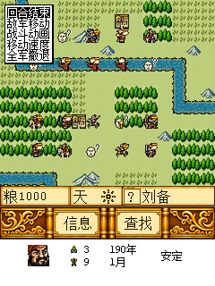
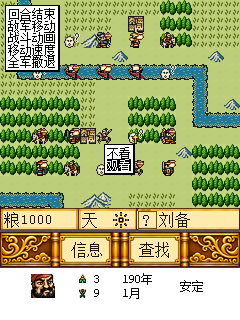

# 战斗菜单与9288S对照

菜单文字来自资源001第9项，两版解码结果都是“回合结束敌军移动战斗动画移动速度全军撤退”，每行四个汉字。第10项为“不看观看”，第11项为“快速慢速”。

| 零基行号 | 显示文字 | 9288S原版与alpha.5行为 | 9588原版及alpha.4行为 |
| --- | --- | --- | --- |
| 0 | 回合结束 | 返回255，战斗结果不改，结束玩家回合 | 相同 |
| 1 | 敌军移动 | 设置敌军移动显示标志，子菜单“不看／观看” | 错设战斗结果2，直接撤退 |
| 2 | 战斗动画 | 设置演出标志，子菜单“不看／观看” | 相同 |
| 3 | 移动速度 | 设置移动标志，子菜单“快速／慢速” | 相同 |
| 4 | 全军撤退 | 设置战斗结果2并返回255，直接退出本场战斗 | 错开“不看／观看”，修改敌军移动标志 |

9288S原版在EXE文件0x782e～0x790f处理此菜单。第4行在0x7894～0x789a将0x027126f6置为2；第1行在0x78d2～0x78d8选择0x027126fa并读取文本10。原9588的0x81c06440函数保留文字顺序，却把第1行接到0x81c0652c的撤退分支，第4行接到0x81c065a4的显示设置分支。alpha.5仅交换这两个错误分支，保持原文本、菜单尺寸、返回约定及其他逻辑。

原始9288S EXE的SHA-256为`4eafbd3c59b64bf56fb810e47de43cb9d1075530801a8f991cf007f510954f9c`，原9588 BDA为`38f3740af4d21ea3108e964b2824b518b1b5cc837e81fcb9b3cfefced7ff8ac6`。原始程序不随仓库分发。此处为静态反汇编与资源核对，不声称本轮运行了9288S原版。

拥有原始文件时可用下列命令重取文本与文件哈希；分支意义来自已检查的原始反汇编，是审阅注释，不是脚本自动推导：

```powershell
python tools/compare_battle_options_reference.py --exe9288s PATH/TO/三国霸业.exe --bda9588 PATH/TO/原版三国霸业.bda --lib9588 build/sango.lib
python tools/test_battle_options.py
# 保留alpha.4的ELF时，还可重现两个旧分支错误
python tools/test_battle_options.py --baseline PATH/TO/alpha4-sango.elf
```

MIPS测试执行真实菜单选择、文字解码、触摸命中和分支，只建模SDK绘制/输入边界。C200模拟器实际点击五行并核对返回值及三项设置，另有26项MIPS取消、键盘与连续操作检查。原生标记只记录执行结果，原始/交付程序中不包含夹具。

原生C200菜单截图：




原始对照记录见[9288S/9588参考](../validation/battle-options-reference.json)，完整修复及哈希见[菜单修复验证](../validation/battle-options-review.json)。
