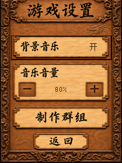
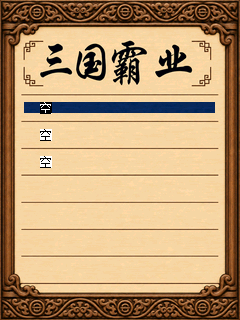

# 游戏设置与木色页面补齐

主菜单第三项改为“游戏设置”，原126×57选中动画的两个状态同步改字。二级页面采用与主菜单一致的木雕背景，固定标题、标签、加减号、制作群组及返回按钮均来自图片素材；只有开关状态、音量百分比和焦点框动态绘制，整页离屏提交。

- 点“背景音乐”切换开关。关闭时停止文件读取、解码、PCM提交和音乐定时器；保留当前场景，重新开启播放当前场景曲目。
- 音量提供0～100%的11个档位。点减号或加号调整，按键上下选择、左右调节；音量为0也停止解码，避免静音时占用刷新时间。默认80%对应此前已验证的SDK衰减值24；退出播放恢复原设备衰减设置。
- “制作群组”打开署名图片，图片底部新增“优化作者 HelloClyde”，保留原作者“通宵虫、南方小鬼”和其他致谢；返回后仍在设置页。
- 返回主菜单时将偏好写入资源目录的 `sango.cfg`。它是独立8字节校验记录，不属于游戏存档；缺失或损坏时沿用默认开、80%。写入失败不影响本次设置生效。

制作群组、重返沙场的存读档页、历史时期页及其8张选中动画也统一补成木色。存档文字、触摸区域、历史时期顺序和动画时间轴保持原坐标。此前图像保留在 `assets/color/variants/before-wood-settings/`，母图、完整GPT Image提示词与裁切记录见 [素材来源](../assets/color/wood-settings-provenance.json)。设置底图使用原空索引078，原87条资源的字节和偏移保留。

重做图片后运行 `python tools/prepare_wood_settings_assets.py` 可从入库母图重新导入；常规构建只打包目标PNG，不调用生成服务。设置代码在 `src/sango_settings.c`，音乐控制在独立音乐模块，新增状态位于原存档区域之外。

`python tools/test_settings.py` 执行真实编译MIPS，覆盖触摸/按键、音量边界、拖动不激活、署名入口/返回、配置编码校验/重新加载及实际音乐流停止与恢复。原生固件检查与截图另记录精确构建哈希，不将模拟器结果称为真机试听。

32项MIPS设置检查与19项原生C200界面检查通过；后者按精确字节载入BDA/LIB/CLR，隔离合成NAND的ECC差异。报告见 `validation/settings-validation.json` 和 `validation/wood-settings-validation.json`，不宣称真机音量或完整战役通过。

| 设置页 | 制作群组 |
| --- | --- |
|  |  |

| 历史时期 | 重返沙场 |
| --- | --- |
|  |  |
