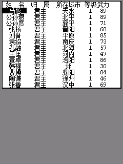
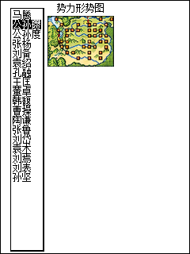
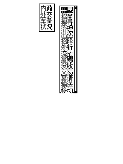

# 菜单整块显示与势力选择响应

内政、外交、军事等弹出菜单原来把每一行文字直接画到可见窗口；武将、物品表单还会逐格绘制。9588 刷新期间能看见文字逐个出现。

`src/sango_ui_paint.c` 使用固定 SDK 的兼容离屏画布，准备整块菜单或整个表单后再复制到窗口。优先复用应用的辅助画布，避免每次进入菜单都分配整屏快照；辅助画布不可用时才申请临时快照。进入输入等待前恢复窗口 context，所有离屏资源都不可用时保持原来的直接绘制和输入回退。新增状态位于原始存档及固定全局区之外。

后续原生 LCD 采样发现，仅切换绘图 context 仍不足以防止中途显示：旧矩形、线条和文字封装中的 draw guard / request redraw 会让 C200 提前显示离屏内容。现在离屏绘制期间抑制这些中途刷新，只在最外层结束后提交完整内容；普通屏幕绘图及资源不足回退仍执行原来的 SDK 刷新。没有增加 GUI 函数表或私有指针调用。

武将、物品表单的外框也移入同一绘制范围。城市属性、提示消息、武将/城市事件及战报框包含完整图文后才提交；粮食、金钱和兵力输入框的第一次提交包含标题、当前数值、上限和四个按钮。滚动及表单翻页保留相同原则。

C200 固件验证发现，原来的辅助矩形反色操作在兼容画布上不会产生选中框。因此文字和表格提交后，再在窗口上执行原来的选中框反色；不把反色移到离屏画布，也不改动原来的字体和行距。调用均经过 SDK 及现有兼容适配层。

势力选择还修复了以下问题：

- 名字每槽补满六字节后，最后的字符串结束符会被覆盖，绘制可能读到后续旧堆数据。现在明确补上结束符，并限制在 250 字节共享缓冲区内。
- 上下选择只移动选中框；实际翻页时才重新绘制名字。无关按键和触摸移动不再重画列表或闪烁城市。
- 确定和退出直接返回，不先执行清除选中框、城市闪烁等绘制操作。
- 超过 255 的选中框纵坐标保留完整数值。空列表直接取消。

原D4保留触摸名字直接确认。后续木质势力选择页改为点选预览头像，再点击“确定”进入；实体按键仍保留，见[势力选择页](RULER_SELECTION.md)。

## 验证

`python tools/test_menu_input.py` 运行编译后的 MIPS 控制器，检查画布嵌套、资源释放、分配失败、输入前恢复context、整块文字和表单提交、原生窗口反色及存档初始数据。基础44项，本地存在旧D3 ELF时另验证一次旧版名字结束符缺陷，共45项。新势力页的138项专属检查见 `tools/test_ruler_ui.py`。

`python tools/test_menu_atomic.py` 增加37项检查，覆盖13种实际弹窗控制器、首次完整提交、复用画布及真实 SDK 刷新封装的抑制/恢复；本地存在修复前 ELF 时再复现5种提前绘制外框的路径。它不会把“文字画在离屏 context 上”单独当作没有中途刷新的证据。

本次26项原生 C200 检查在8种弹窗的首个内容绘制入口暂停，读取实际 LCD：此时屏幕应仍是进入前的完整画面。继续运行后核对完整菜单、表单和数字面板；另加载修复前的精确 BDA，复现提前显示外框，并验证完成后的菜单像素不变。见 `validation/menu-atomic-firmware-validation.json`。同时重新通过19项设置、历史时期和存档页面检查，见 `validation/menu-paint-settings-firmware-validation.json`。

验证采用独立 NAND 和不进入交付 BDA 的 RAM 场景脚本，BDA、LIB 和 CLR 以原字节载入。断点采样验证没有把外框提前提交，不代表硬件垂直同步翻页、真机延迟或完整战役测试。此前12项菜单输入检查及旧截图保留为历史证据，其报告中的旧 BDA 哈希不算本次验证。

