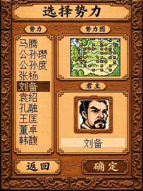
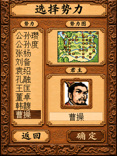

# 势力选择页

势力选择采用与主菜单一致的旧木色背景。左侧显示十行势力名称，右侧上方保留原势力图，下方显示当前君主的48×48彩色头像与姓名；上下选择或点选名称时同步更新预览。名单使用原生16像素透明文字，选中行使用深木色图片。城市标记仍由真实城市坐标与君主归属计算。

触摸名字先预览，点击底部“确定”进入，点击“返回”取消。实体方向键、确定、退出仍有效。向下移动到第十一项后滚动名单，不重载整张底图。静态底图和势力图保存在已有游戏画布，完整页面在已有辅助画布上组成；不为每次切换分配快照。

首次进入由SDK原尺寸RGB565整块绘制接口完成底图、地图、选中条和头像，名单和姓名也在同一离屏画布上准备，最后一次提交完整页面；不会先把空白底图交给窗口。所有绘制指定目标画布，不临时改写窗口context，也不逐像素绘制彩色图片或在每八行中间多次提交PCM。

切换时只恢复受影响的名单行、势力图、头像和姓名区域，用一个绘制事务提交。相邻切换的窗口更新面积为13117像素，整屏为76800像素；城市闪烁只提交84×64的势力图，不再逐城刷新窗口。该数值是工作量边界，不是对真机帧率的测量。缺少辅助画布时先借用消息画布，均不可用时只在进入页分配一次，取消/确定时释放自己分配的画布，保留应用所有者。

新资源均纳入 `sango.lib` 和配套 `sango.clr`，使用原来空闲的52、53、77号索引槽；87条原资源的排列、记录、遮罩和动画未改，`--original-only` 仍与原LIB逐字节一致。

| 资源 | 内容 | 来源 |
| --- | --- | --- |
| 052 | 240×320木质底图 | GPT Image生成并按布局参考修订，名单/地图/头像区域留空 |
| 053 | 33帧48×48君主预览头像 | 按四个剧本城市归属得到实际君主ID，从对应剧本的原GPT Image高清母图裁切 |
| 077 | 56×18深木色选中条 | 从已有GPT Image木色菜单母图的无字木纹区域裁切 |

头像未从24像素图直接放大，也未重新猜测人物身份。同一剧本的武将ID同时决定姓名、原头像和新预览帧；四个剧本共50项君主选择映射到33张图。原图复用导致的同脸保留为原有复用关系。母图、裁切框、姓名/ID/帧号映射和提示词见 [来源记录](../assets/ruler/provenance.json)。

```powershell
# 仅在有意更新美术时重新裁切/转换；不调用生成服务
python tools/prepare_ruler_assets.py
python build.py
python tools/test_sango_lib.py
python tools/test_color_assets.py
python tools/test_ruler_ui.py
python tools/test_ruler_response.py
```

138项真实MIPS检查覆盖四个剧本全部50项君主的头像像素和姓名ID、触摸先预览后确认、轻微触摸位移、按钮边界、滚动、取消与画布所有权。另有34项响应回归覆盖第一帧完整后才读输入、首个点击/按键立即有效、显式离屏目标、局部更新面积、无每次分配、滚动、地图闪烁及内存不足回退。

21项原生C200检查验证四个剧本的实际头像、原生字体、静态底图、触摸预览与确定/返回、连续按键及滚动；首次页面检查后立即发送80ms手势，模拟器在1秒内完成预览。这里是本地模拟器的输入和截图观察，不代表真机耗时。报告见 `validation/ruler-response-validation.json` 与 `validation/ruler-response-firmware-validation.json`；独立NAND和精确字节BDA/LIB/CLR装载隔离合成NAND的ECC差异。




更新时需一起覆盖BDA、LIB和CLR，保留原有音乐和存档。
