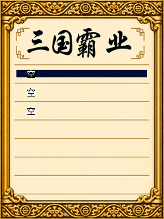
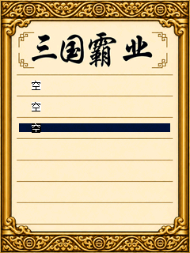

# 存读档槽位布局

存档和读档共用 `sango_save_choose_slot`、`sango_save_draw_slots` 与046号底图。
底图以240×320原尺寸绘制，前三个槽位的横线在y=121、148、175附近。
旧文字及选中条起点为116、143、170，12像素高的字会穿过分隔线。

文字起点调整为102、129、156，横向保持x=40；选中条覆盖x=24～215并与文字等高。
触摸区域同样以27像素为一行，三个槽位共享 `include/sango_save.h` 的布局常量。
方向键循环、触摸确认和取消保持原行为；存档槽编号、六个文件路径及读写数据布局沿用原实现。

| 第一槽 | 第三槽 |
| --- | --- |
|  |  |

截图来自修复工作版在本地C200模拟器的原生字体和真实存读档选择器。
诊断夹具只建立空槽状态，程序、LIB和CLR的准确字节通过RAM装载隔离合成NAND的ECC误差；
未宣称本轮完整真机存读档验证。已有存档、残缺文件对、名称及年份、按键循环与触摸边界，
另由编译MIPS检查覆盖。

```powershell
python tools/test_save_layout.py
python tools/test_touch_input.py
```
