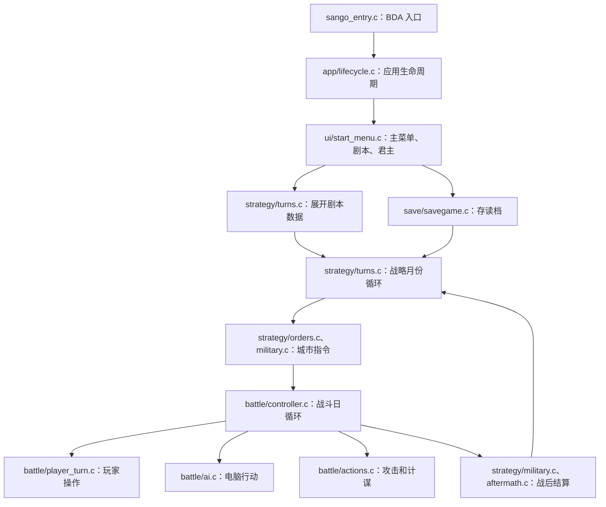

# 源码导航

游戏逻辑已从 `sango_game.c` 拆成 42 个按职责划分的 C 模块，共 446 个恢复函数。
业务代码使用有含义的函数名；原地址、旧名和新位置的对照保存在根目录 `source-map.json`。
完整的可点击列表见 [函数索引](FUNCTION_INDEX.md)。

## 从主流程开始



建议先读这些函数：

| 要理解的流程 | 入口及文件 |
| --- | --- |
| 加载、选择会话、运行、释放 | `sango_game_lifecycle`，[app/lifecycle.c](../src/app/lifecycle.c) |
| 主菜单、新游戏、读档 | `sango_select_session`，[ui/start_menu.c](../src/ui/start_menu.c) |
| 月份推进与胜负判断 | `sango_strategy_run_months`，[strategy/turns.c](../src/strategy/turns.c) |
| 城市指令分派 | `sango_city_execute_command`，[strategy/orders.c](../src/strategy/orders.c) |
| 战斗准备、双方行动、每日耗粮 | `sango_battle_run`，[battle/controller.c](../src/battle/controller.c) |
| 攻击与计谋执行 | `sango_battle_execute_normal_attack`、`sango_battle_execute_skill`，[battle/actions.c](../src/battle/actions.c) |
| 存档槽位与读写 | `sango_save_choose_slot`、`sango_save_load_slot`、`sango_save_write_slot`，[save/savegame.c](../src/save/savegame.c) |
| 资源索引、变长条目、文本解码 | `sango_resource_item`、`sango_resource_read_text`，[resources/library.c](../src/resources/library.c) |

## 目录职责

| 目录 | 模块及职责 |
| --- | --- |
| [app](../src/app) | `boot`：入口和状态区初始化；`lifecycle`：应用流程；`memory`：会话内存 |
| [battle](../src/battle) | `controller`：战斗流程；`army`：队伍和兵力；`movement`：移动范围；`combat_math`：属性、伤害和耗粮；`ai`：电脑决策；`player_turn`：操作和目标选择；`field`：地图、日更新、状态；`overview`：战场信息；`actions`：攻击、计谋和演出 |
| [strategy](../src/strategy) | `turns`：月份循环、太守刷新、剧本；`session`：日历事件包装；`orders`：指令分派及内政；`domestic`：排队指令执行；`military`：侦查、征兵、出征和战后衔接；`aftermath`：城池和势力变化；`rosters`：名册；`map`：战略地图、城市与物品索引；`calendar`：经济、灾害、登场；`items`：道具；`ai`：城市电脑策略 |
| [ui](../src/ui) | `start_menu`：主菜单、剧本和君主；`system_menu`：系统菜单；`menu_and_text`：菜单和文字；`numeric`：数值输入；`info_panels`：武将和城市资料；`lists`：列表；`city_details`：城池详情 |
| [resources](../src/resources) | `library`：`sango.lib` 索引、文本读取、解码和诊断绘字 |
| [render](../src/render) | `animation`：动画指令和帧；`raster`：位图、字模、裁剪及像素绘制 |
| [save](../src/save) | `savegame`：槽位选择、存读档、存档摘要 |
| [platform](../src/platform) | `sdk_bindings`：命名 SDK 入口；`window_graphics`：窗口与绘制；`input_dialog`：输入与对话框；`event_loop`：消息循环 |
| [runtime](../src/runtime) | `strings`、`format`、`libc`、`soft_float`：恢复的运行库，独立于游戏规则 |

已有的独立修复模块继续保留：
`src/sango_statusbar.c`（战略底栏）、`src/sango_credits.c`（制作群组）、
`src/sango_battle_ui.c`（战斗按钮、触摸及居中弹窗）。
素材入口仍为 `assets/library/manifest.json`；[用途核对](../assets/library/代码用途核对.md)
已同步指向新的语义函数和模块位置。

## 状态、格式与接口

| 头文件 | 用途 |
| --- | --- |
| [sango_state.h](../include/sango_state.h) | 武将、城市、战场部队、指令和战斗属性结构，记录尺寸和字段偏移的编译期检查 |
| [sango_resource_format.h](../include/sango_resource_format.h) | LIB 记录头、变长索引项和位图头；资源读取代码已采用类型视图 |
| [sango_legacy_memory.h](../include/sango_legacy_memory.h) | 集中存放旧状态区和初始化数据的地址视图，避免业务函数重复定义地址宏 |
| [sango_types.h](../include/sango_types.h) | 标准整数类型、O32 宽度约束、旧运行库所需的小型兼容定义 |
| `sango_app.h`、`sango_battle.h`、`sango_strategy.h`、`sango_ui.h` 等 | 各领域函数声明；`sango_internal.h` 是内部汇总入口 |
| [sango_sdk_bindings.h](../include/sango_sdk_bindings.h)、[bda_sango_compat.h](../include/bda_sango_compat.h) | 公共 SDK 与项目兼容实现的切换点 |

武将、城市、战场槽位的数组下标从 **0** 开始。势力归属、太守和装备字段通常以 **0 表示无**，
有效值为下标加 1。资源 ID 和资源子项从 **1** 开始；导出图片帧号从 **0** 开始。
这些区别影响存档、阵列和资源读取，修改调用时应保持原约定。

部分复杂流程继续使用原布局的字节偏移。结构定义是这些布局的依据，不能任意改变记录大小。
同一地址的不同整数宽度或指针视图带有 `_view2`、`_view3` 后缀，保留原来的访问宽度。
`abi_storage` 及其局部宏用于保留恢复代码中的栈区相邻关系；它们没有被误写成独立数组，
以免改变跨字段拷贝、原格式和旧调用 ABI。`sango_data.c` 只保存初始化数据，不含业务逻辑。

## 构建与继续修改

源文件是实际的编辑入口。构建时，`tools/build_engine.py` 按 `source-map.json` 的函数顺序
生成只有 `#include` 的 `build/sango_engine.c`，让 GCC 保留原有的跨函数优化及固定地址布局。
这个生成文件不存放手写逻辑。第一阶段拆分保持整份 BDA 逐字节一致。
第二阶段继续整理复杂函数，编译结果已变化；初始化数据、状态和存档布局保持原约定，
已覆盖用例的新旧行为对照见 [复杂函数整理](CONTROL_FLOW_REFACTOR.md) 和 [验证记录](VALIDATION.md)。

`sango.elf` 额外保留已链接函数的旧名别名，供现有机器码对照脚本定位；这些调试符号
不进入 BDA，也不作为新的 C API 使用。被内联或消除的函数不会凭空生成调试入口。

```powershell
python tools/source_index.py --find battle_run
python tools/source_index.py --find FUN_81c058b8
python tools/source_index.py --find 81c16940

# 移动或增删函数后同步 source-map.json，再生成索引、核对资源依据。
python tools/source_index.py
python tools/audit_resource_usage.py
python tools/source_index.py --check
python tools/audit_resource_usage.py --check
python build.py
```

继续修改前，可用 `python tools/check_modules.py` 检查42个模块能否分别编译，防止统一编译
掩盖跨文件声明或宏泄漏。本轮重点整理了输入循环、列表、计谋、出征、搜索、AI、月度事件、
绘图和格式化运行库。保留的共享清理、菜单回退及输出合并标签已按职责命名。
剩余短函数也已完成命名整理：446个函数不再使用 `uVar`、`param_N`、`LAB_地址` 等旧式临时名。
`source_index.py --check` 同时检查这项约束；旧名仅在 `source-map.json` 中保留用于追溯。
SDK内部字段沿用其已知定义，未用参数保留 `unused` 标记，未确认的空入口保留 `stub` 名称。
部分恢复布局及原控制流仍然存在，不能把当前工程说成原作者源码。
本轮逐词核对、机器码一致性及复验命令见 [短函数命名整理](IDENTIFIER_CLEANUP.md)。
